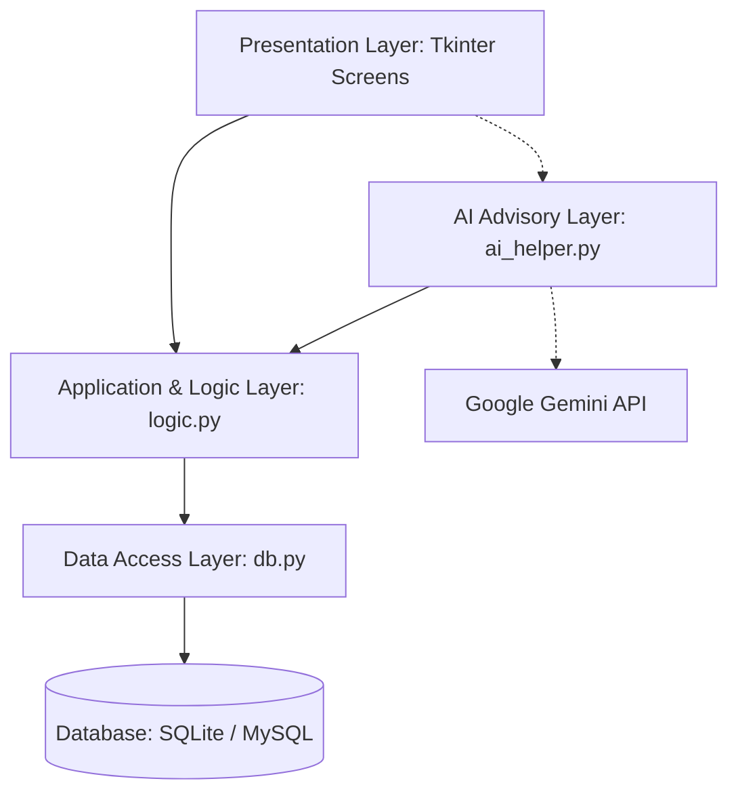
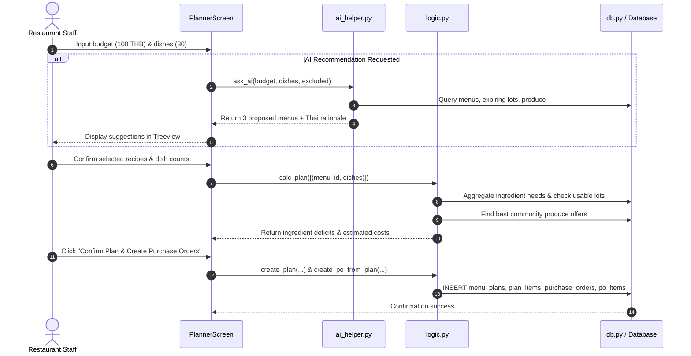

# ARCHITECTURE.md — System Architecture Specification

**Application:** เมนูชุมชน (Community Menu Planner)  
**Version:** 1.0.0-audit  
**Target Environment:** Windows Desktop (Python 3.10+ / Tkinter)  
**Architecture Pattern:** Layered Model-View-Presenter / Service-Oriented Local Desktop Architecture  

---

## 1. System Overview

Community Menu Planner is an offline-first Windows desktop application architected to assist local restaurants in daily menu planning, inventory lot management, community produce purchasing, and cost tracking.



---

## 2. Layered Architectural Decomposition

### 2.1 Presentation Layer (`screens/`, `main.py`)
- **Technology:** Python `tkinter` and `tkinter.ttk`, themed with custom ttk styles in `screens/widgets.py`.
- **Responsibilities:**
  - Rendering 7 distinct functional views via a tabbed Notebook interface (`main.py`).
  - Collecting user input, displaying tabular data with color-coded alerts (low stock, expiring lots, budget overruns).
  - Executing asynchronous tasks (e.g., AI queries in `screens/planner.py`) via daemon background threads to ensure the UI thread never freezes.
- **Components:**
  - `main.py`: Application shell, header with Thai Buddhist calendar date formatting, tab navigation, global exception hook (`report_callback_exception`).
  - `screens/home.py`: Operational dashboard with metric cards and critical alert tables.
  - `screens/inventory.py`: Full inventory and lot management interface.
  - `screens/recipes.py`: Menu and recipe formula editor.
  - `screens/community.py`: Farmer registry and produce availability manager.
  - `screens/planner.py`: Menu planning, AI recommendation dialogue, cost and deficit calculator.
  - `screens/purchase.py`: Purchase order generator and goods receipt controller.
  - `screens/report.py`: Period-based reporting on purchasing, usage, waste, and community economic impact.
  - `screens/widgets.py`: Reusable styled components (`Table` with row striping, `FormDialog`, `make_card`).

### 2.2 Business Logic & Calculation Layer (`logic.py`)
- **Responsibilities:**
  - Serving as the single source of truth for all business rules, unit conversions, cost evaluations, and inventory mutations.
  - Zero reliance on UI frameworks (completely headless and unit-testable).
  - Providing transactional consistency across multi-step mutations (e.g., issuing ingredients according to lot expiration dates).
- **Core Subsystems:**
  1. **Unit Standardizer (`to_std`, `fmt_qty`):** Standardizes weights (e.g., `กก.` to `กรัม`) while strictly forbidding cross-type conversions (e.g., weight to count).
  2. **FIFO Lot Engine (`suggest_lots`, `issue`, `waste_lot`, `adjust_lot`):** Prioritizes inventory consumption by earliest `use_by` date. Prevents negative stock via `AppError`.
  3. **Plan Optimizer & Calculator (`calc_plan`):** Combines ingredients across multiple selected recipes, subtracts non-expired usable inventory, finds the cheapest active community producer, and produces purchase deficit lines with accurate cost projections.
  4. **Procurement Dispatcher (`create_po_from_plan`, `receive_po`):** Partitions needed purchases by farmer, generates pending purchase orders, and converts fulfilled purchase orders into new inventory lots with calculated shelf lives.

### 2.3 Data Access & Persistence Layer (`db.py`)
- **Responsibilities:**
  - Connection lifecycle management, schema migration / DDL execution, and demonstration seed dataset provisioning.
  - Providing unified database connectivity (`get_conn()`) with transaction commit and rollback guarantees.
  - Managing data integrity via relational foreign keys and unique constraints.
- **Relational Data Model:**
  - `ingredients`: Master ingredient catalog (code, name, standard unit, minimum safety stock, shelf life days).
  - `lots`: Physical inventory batches (ingredient reference, received date, `use_by` expiration date, remaining quantity, unit cost).
  - `movements`: Immutable audit log of all stock changes (`IN`, `USE`, `WASTE`, `ADJUST`).
  - `menus` & `recipe_items`: Recipe specifications containing per-dish ingredient quantities.
  - `farmers` & `produce`: Local supplier registry and time-sensitive farm produce offers.
  - `menu_plans` & `plan_items`: Daily planned meal schedules with budget and status (`DRAFT`, `CONFIRMED`, `USED`).
  - `purchase_orders` & `po_items`: Purchase records tracking procurement status (`PENDING`, `RECEIVED`, `CANCELLED`).

### 2.4 External Advisory Layer (`ai_helper.py`)
- **Responsibilities:**
  - Filtering and summarizing local store constraints (surplus inventory, expiring lots, community offerings, budget, dish targets) into a structured prompt.
  - Requesting strictly structured JSON recommendations (`gemini-flash-lite-latest`) using typed schemas.
  - Validating all returned menu codes against the local database.
  - **Security & Decoupling Principle:** The AI never performs calculations, never writes to the database, never alters inventory, and never receives confidential supplier contact details.

---

## 3. Data Flow & Transaction Lifecycle



---

## 4. State Transition Models

### 4.1 Menu Plan State Machine
```text
[DRAFT] ──> Confirm Plan ──> [CONFIRMED] ──> Execute Issue (use_plan) ──> [USED]
```
- **Rule:** A plan in `USED` status cannot be re-issued, preventing accidental double-consumption of inventory.

### 4.2 Purchase Order State Machine
```text
           ┌──> Cancel Order ─────────> [CANCELLED]
[PENDING] ─┤
           └──> Receive Goods (receive_po) ──> [RECEIVED] (Lots Created, Stock Injected)
```
- **Rule:** Only `PENDING` orders can be received or cancelled. Once `RECEIVED`, inventory lots are created and movements are logged immutably.

---

## 5. Architectural Quality Attributes

1. **Safety & Zero-Deficit Assurance:** Stock can never drop below zero. If required quantity exceeds usable lots, `suggest_lots` aborts with an informative `AppError`.
2. **Auditability:** Direct manual updates to `lots.qty_left` are strictly prohibited; all adjustments require an explicit reason string logged to `movements`.
3. **Resilience & Graceful Degradation:** Complete application workflow (inventory, recipes, manual planning, procurement, reporting) operates 100% offline without network connectivity or API keys.
